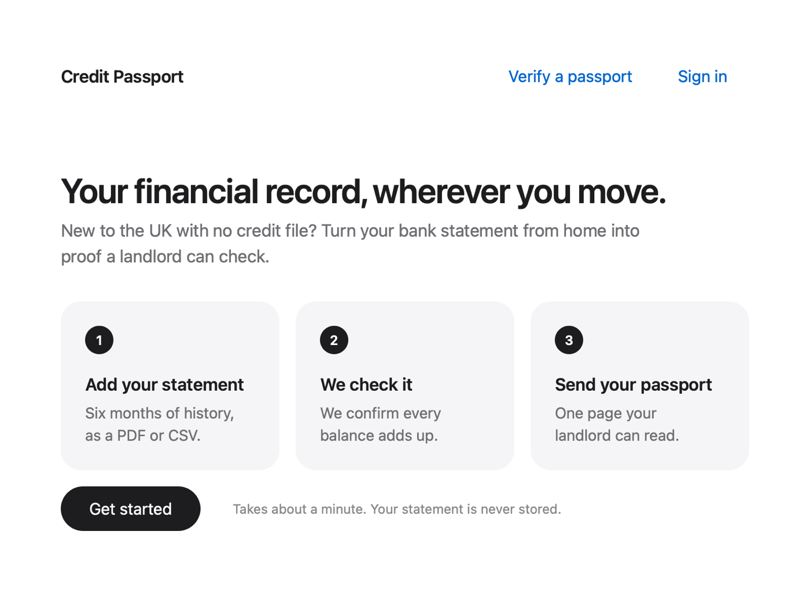
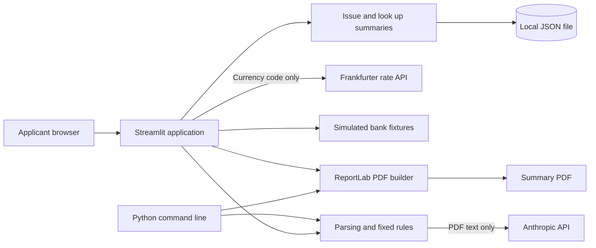
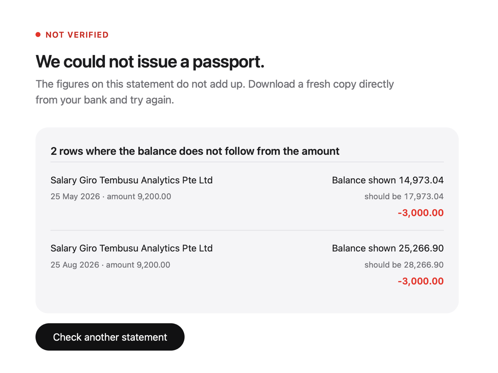
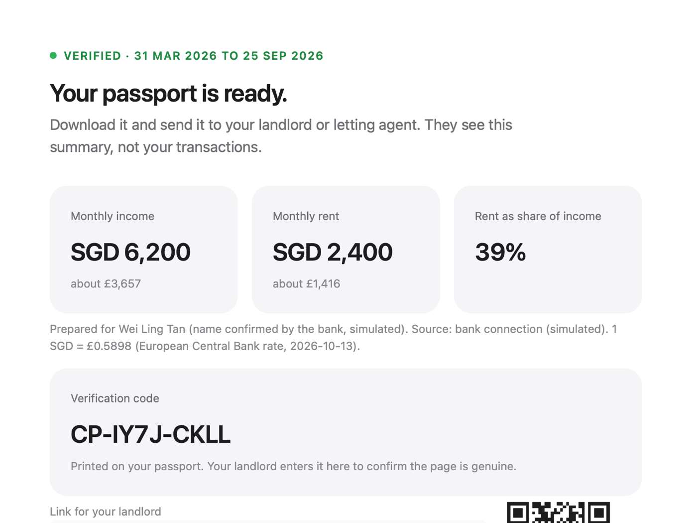
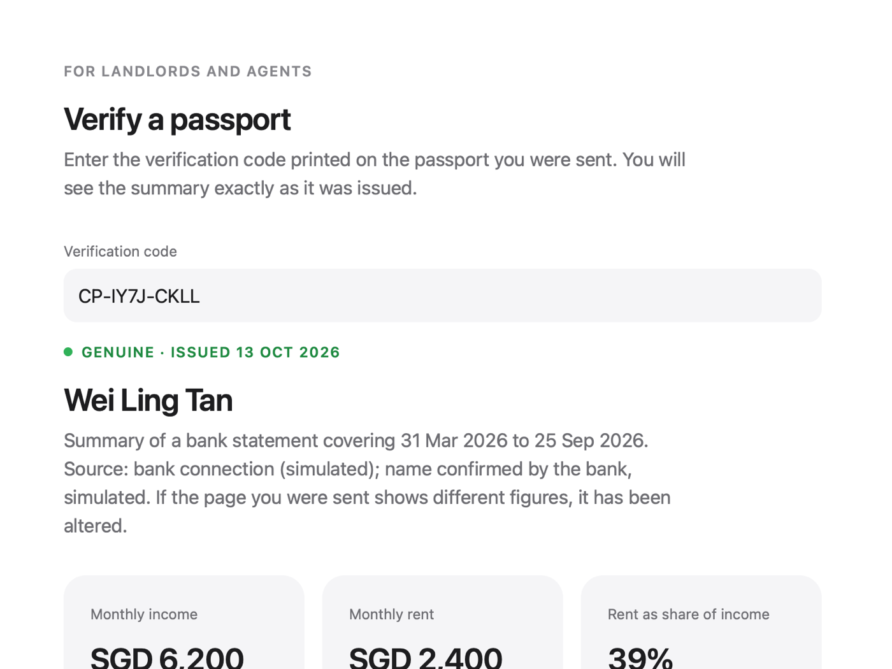

# Credit Passport

Turn a bank statement into a summary of recurring income, rent payments and observed balances.



Built in one evening at a fintech hackathon in London on 13 October 2026, hosted by Singapore Global Network and LSE Generate.

## Description

Credit Passport is a Python prototype for people moving to the UK who want to share their overseas financial history with a landlord or letting agent. It reads a CSV or text-based PDF statement, checks the running balances and produces a PDF summary. The browser interface lets the applicant inspect the rows behind each finding, saves the issued summary locally and provides a code a landlord can use to retrieve it. The exported report and saved record omit the transaction table.

"Verified" means that the supplied balances reconcile and the rows are in chronological order. It does not establish that the statement is authentic, complete or owned by the applicant. A landlord lookup retrieves the saved summary; it does not authenticate the underlying bank statement. Credit Passport does not produce a credit score or make a lending decision. The included demonstrations use fictional Singapore-dollar and Indian-rupee data. Bank connections and account sign-in are simulated.

## Table of Contents

- [Description](#description)
- [Features](#features)
- [Tech Stack](#tech-stack)
- [Architecture Overview](#architecture-overview)
- [Installation](#installation)
- [Usage](#usage)
- [Configuration](#configuration)
- [Screenshots / Demo](#screenshots--demo)
- [API / CLI Reference](#api--cli-reference)
- [Tests](#tests)
- [Roadmap](#roadmap)
- [Contributing](#contributing)
- [License](#license)
- [Contact / Support](#contact--support)

## Features

- Read CSV statements locally or transcribe text-based PDF statements through Anthropic.
- Check running balances from the second row onwards and reject rows that are out of date order.
- Find recurring credits and likely rent payments using fixed rules, with transaction evidence available in the browser.
- Summarise typical income, typical rent, their ratio and negative balances observed in the supplied rows.
- Download a report when the balance check passes, or show the inconsistent rows when it fails.
- Run the same processing pipeline from the browser, command line or Python.
- Save issued summaries with verification codes for landlord lookup, share links and QR codes.
- Demonstrate bank consent and saved passports without contacting a bank or sending a sign-in email.
- Read common CSV column aliases and reverse a newest-first statement for balance checking.
- Rehearse with genuine, edited, missed-rent and Indian-rupee fictional statements.

Only balance consistency and date order determine whether a report can be issued. Findings about income, rent and negative balances are advisory. A fabricated statement whose numbers add up can pass.

## Tech Stack

| Technology | Use | Declared dependency |
| --- | --- | --- |
| Python | Application and command line | CI uses Python 3.13; no minimum version is declared |
| Streamlit | Browser interface, session state and caching | `streamlit>=1.45` |
| pandas | Transaction tables and rule calculations | `pandas>=2.2` |
| pdfplumber | Extract text from PDF statements | `pdfplumber>=0.11` |
| Anthropic SDK | Transcribe PDF text into transaction rows | `anthropic>=0.77` |
| ReportLab | Generate PDF summaries | `reportlab>=4.4` |
| requests | Retrieve a GBP exchange rate in the browser flow | `requests>=2.32` |
| Segno | Generate verification-link QR codes | `segno>=1.6` |
| pytest | Automated tests | `pytest>=8` |
| GitHub Actions | Test workflow on pushes and pull requests | [Workflow](.github/workflows/tests.yml) |

These are lower bounds from [requirements-streamlit.txt](requirements-streamlit.txt), not a locked dependency set. [requirements.txt](requirements.txt) holds the smaller pinned set the Vercel demo installs.

## Architecture Overview



Streamlit and the command line share Python parsing and rules modules; PDF extraction sends statement text to Anthropic, and the browser separately requests a rate from Frankfurter. The web flow saves issued summaries in `data/issued.json`, while simulated bank connections read local fixtures. Upload bytes remain in Streamlit session state and parsed results are cached without an application-defined expiry; there is no separate backend API or database server.

See [ARCHITECTURE.md](ARCHITECTURE.md) for the data model, rule details and implementation limits, or open the [interactive architecture map](https://younis-y.github.io/credit-passport-demo/). The map's [editable JSON](docs/diagrams/credit-passport.architecture.json) records its components and source references.

The [map publishing workflow](.github/workflows/architecture-pages.yml) publishes only the HTML diagram, to GitHub Pages at [younis-y.github.io/credit-passport-demo](https://younis-y.github.io/credit-passport-demo/). The hosted page loaded on 13 October 2026.

## Installation

Use Python 3.13 to match the CI configuration, plus Git and access to the configured repository. Dependency installation needs an internet connection. Reading PDF statements also needs an Anthropic API key and access to the configured model.

From a terminal on macOS or Linux:

```sh
git clone https://github.com/younis-y/credit-passport-demo.git
cd credit-passport-demo
python3.13 -m venv ../credit-passport-venv
source ../credit-passport-venv/bin/activate
python -m pip install -r requirements-streamlit.txt -r requirements-dev.txt
python -m pytest -q
```

For an existing checkout, start from its directory and omit the clone command. The example keeps the virtual environment outside the repository because the current `.gitignore` does not exclude a local `.venv` directory.

The CSV command-line demo needs no API key and makes no application network calls. Start with that path before configuring PDF extraction.

## Usage

### Browser application

```sh
python -m streamlit run app.py
```

Open [localhost:8501](http://localhost:8501), choose **Get started**, optionally enter the name to display on the report, then upload a statement. Review the findings and their evidence before downloading the passport.

- For a demo without an API key, upload `samples/genuine.csv` manually.
- **Genuine** loads `samples/genuine.pdf`, so that button needs the PDF service and key.
- **Edited** loads `samples/tampered.csv` and shows the two inconsistent balances.
- **Missed rent** shows an arithmetically consistent statement with no identified rent payment in July 2026. The report is still issued with that finding.
- **India, in rupees** reads `samples/india.csv`, including its column aliases, newest-first ordering and INR currency.
- **Connect your bank (demo)** opens a simulated consent flow and reads a local fixture. It contacts no real bank.

Choose the source currency for CSV uploads. PDF extraction supplies the currency when it can, otherwise the selected currency remains. After a statement passes, the browser requests a GBP rate. If that fails, it uses a fixed demonstration rate for SGD, INR, USD, EUR, HKD, MYR or AUD; an unlisted currency falls back to `1.0`. These constants are not current exchange-rate guarantees.

### Sharing and demo accounts

The web result automatically saves its summary and supplies a code such as `CP-XXXX-XXXX`. **Verify a passport** retrieves that saved record. The link and QR code open the same lookup view; for a local run, the other device needs to reach the running application on the same network. Generated links use HTTP, and public access has not been verified.

**Email my landlord** opens the user's email application with a prepared message. It does not send email or attach the PDF automatically; download and attach the report yourself. **Save to my account** and **Sign in** accept an email address without verifying it or sending a login link. They demonstrate saved-record navigation, not secure account access. Anyone with a verification code can retrieve its summary without signing in.

### Command-line demonstration

```sh
python -m passport samples/genuine.csv --pdf /tmp/credit-passport-demo.pdf
python -m passport samples/tampered.csv
```

The first command prints `VERIFIED` and writes a PDF. The second prints `CANNOT VERIFY` and returns exit code `1`. For the genuine fixture, the rules find typical income of SGD 6,200, typical rent of SGD 2,400 and a rent-to-income ratio of about 38.7%. Its 67 rows include an opening balance on 31 March 2026 and transactions through 25 September 2026.

The CLI defaults CSV currency to SGD, has no currency option and always uses `0.58` for its indicative GBP conversion. Use the browser or Python API to supply another CSV currency. The CLI does not fetch a live rate, save a registry record or issue a verification code. A `--pdf` path may overwrite an existing file, so choose an output path you intend to replace.

### Vercel synthetic CSV demo

A second, smaller interface in `server.py` (Flask) reuses the same Python checks and PDF report without an AI service, bank connection or database. It accepts synthetic CSV input and includes seven deterministic scenarios with an expected-results guide and a downloadable test pack.

```sh
python -m pip install -r requirements-dev.txt
python -m flask --app server run --port 8510
```

Open [localhost:8510](http://localhost:8510), choose a scenario, inspect the findings and evidence, and download a synthetic report when the arithmetic and date-order checks pass. See [DEPLOYMENT.md](DEPLOYMENT.md) for the Vercel setup and its limits, and [the test data guide](synthetic_demo/README.md) for expected outcomes. This interface is stateless: it leaves out the Streamlit account, sharing, simulated bank and verification-code flows.

### CSV format

Column names are case-insensitive and surrounding spaces are ignored. Supply `date`, `description`, `balance` and either a signed `amount` column or both `deposit` and `withdrawal`. The parser also accepts aliases such as `txn date`, `narration`, `running balance`, `credit` and `debit`; the full list is in [parse.py](passport/parse.py). If both amount formats are present, `amount` takes precedence.

```csv
date,description,amount,balance
31/03/2026,Opening balance,0,8450.00
01/04/2026,Rent,-2400.00,6050.00
```

Credits are positive and debits negative. The parser reads mixed date formats day-first and reverses all rows when the first date is later than the last; it does not otherwise sort the statement. At least two rows are required. Recurring income or rent detection needs matching payments in at least three separate months. A blank or malformed amount or balance, an unreadable date or a row with the wrong number of cells is rejected with a message rather than guessed at; blank cells are allowed only in separate deposit and withdrawal columns.

## Configuration

| Setting | Purpose | Default or current behaviour |
| --- | --- | --- |
| `ANTHROPIC_API_KEY` | Authorises PDF transcription | Required for PDF input; read from the process environment |
| `PASSPORT_MODEL` | Selects the Anthropic model | `claude-haiku-4-5-20251001`; read when the parser module imports |
| [.env.example](.env.example) | Documents the key variable | Reference only; the application does not load `.env` files automatically |
| [.streamlit/config.toml](.streamlit/config.toml) | Sets the light theme and minimal toolbar | No deployment or access-control configuration |
| `data/issued.json` | Local issued-summary store | Created by the web flow; contains summary fields, applicant details and an optional owner email; `data/` is ignored by Git |

Provide the key to the process through your shell or deployment secret configuration. Do not commit it or paste it into an issue. Set `PASSPORT_MODEL` before starting the application if a different available model is required. The configured model's current account availability has not been checked as part of this documentation work.

PDF extraction sends the entire extracted statement text to Anthropic. Scanned PDFs without a text layer are unsupported. The browser keeps upload bytes in session state and caches parsed results; returning to the upload screen or signing out does not explicitly clear them. Issued summaries persist in the local JSON file, whose writes have no locking or atomic replacement. The repository defines no retention policy or verified deletion process. Use the fictional fixtures for demonstrations until the handling of real personal data and access controls has been reviewed.

## Screenshots / Demo

| Item | Location or status |
| --- | --- |
| Browser demo | Run locally with the command above |
| Genuine CSV | [samples/genuine.csv](samples/genuine.csv) |
| Genuine PDF | [samples/genuine.pdf](samples/genuine.pdf), requiring Anthropic for extraction |
| Edited CSV | [samples/tampered.csv](samples/tampered.csv) |
| Missed-rent CSV | [samples/missed_rent.csv](samples/missed_rent.csv) |
| Indian-rupee CSV | [samples/india.csv](samples/india.csv) |
| Interactive system map | [Open the Archify map](https://younis-y.github.io/credit-passport-demo/) |
| Application screenshots | Below, from the fictional demo data |
| Public deployment | The architecture map is hosted on GitHub Pages; the application itself runs locally |

| An edited statement is caught | A passport is issued |
| --- | --- |
|  |  |

| The landlord's view | Welcome |
| --- | --- |
|  |  |

The report is one page for the included fixture. Arbitrary uploaded text is not guaranteed to fit one page. Its footer always describes the project as a prototype built on fictional sample data.

## API / CLI Reference

The Streamlit application has no HTTP API; the Flask demo's routes are in [server.py](server.py). The public entry point within the Python package is:

```python
from pathlib import Path
from passport.pipeline import run

statement = Path("samples/genuine.csv")
result = run(statement.name, statement.read_bytes(), currency="SGD")
print(result.currency)
print(result.passport["verified"])
print(result.passport["monthly_income"])
```

`run(name, data, currency="SGD")` returns the normalised transaction DataFrame, currency code and passport dictionary in a `Result`. For `samples/india.csv`, pass `currency="INR"`. A non-empty currency detected from a PDF takes precedence over the caller's value. See [the data model](ARCHITECTURE.md#data-model) for the result fields. Python pipeline calls alone do not create registry records.

```text
python -m passport STATEMENT [--pdf OUTPUT]
```

| Argument or result | Meaning |
| --- | --- |
| `STATEMENT` | Path ending in `.csv` or `.pdf`, case-insensitive |
| `--pdf OUTPUT` | Write a report if the balance check passes; the parent directory must exist |
| Exit `0` | The supplied balances and date order pass |
| Exit `1` | The supplied balances or date order fail; no report is written |
| Exit `2` | A handled parsing or input-file error |

Provider exceptions and output-write errors are not fully covered by these exit-code conventions and can terminate with a traceback. A failed check does not remove an older file already present at the requested output path.

## Tests

See [docs/DEMO.md](docs/DEMO.md) for a step-by-step demonstration script, expected results for every sample, what each test proves, and the browser walkthrough.

```sh
python -m pytest -q
```

The pytest suite covers the genuine fixture summary, edited balances, report contents and export refusal, model-shaped text parsing, selected malformed inputs, CLI verdicts, missed rent, registry lookup, an Indian CSV layout, the simulated bank feed and account record listing, plus CSV input validation, the generated synthetic scenarios and the Flask demo's routes. Registry tests use temporary files. The suite needs no API key; the PDF transcription test constructs model-shaped text from the CSV rather than calling Anthropic.

Local verification on 13 October 2026 passed the sixteen tests that existed then with Python 3.13.5; after the Flask demo was added the suite stood at 95 tests, all passing on 13 October 2026. Separate CLI checks confirmed exit codes `0`, `1` and `2` for the genuine fixture, edited fixture and a missing file respectively; only the genuine fixture produced a new PDF. A separate browser walkthrough of 58 checks passed the same day; see [docs/DEMO.md](docs/DEMO.md). These checks do not establish real-bank PDF accuracy, live provider availability, email delivery, phone access or deployment readiness.

[GitHub Actions](.github/workflows/tests.yml) is configured to run the suite on pushes and pull requests using Python 3.13. The run for the latest commit on 13 October 2026 passed.

## Roadmap

These are proposed improvements, not scheduled commitments:

- Validate currency codes and add explicit currency selection to the CLI.
- Replace fixed demonstration exchange rates with a validated rate or omit the conversion.
- Replace simulated sign-in with verified authentication and define lookup and record-ownership permissions.
- Define upload, cache and registry retention, deletion and safe diagnostics; make registry writes safe for concurrent use.
- Test extraction on a broader set of synthetic bank layouts and handle long documents deliberately.
- Explore direct bank data as a separate integration; the current consent flow reads fixtures and has no open-banking or SGFinDex integration.

## Contributing

Use the [repository issue tracker](https://github.com/younis-y/credit-passport-demo/issues) to describe a reproducible problem or proposed change, then submit a focused [pull request](https://github.com/younis-y/credit-passport-demo/pulls). Run `python -m pytest -q` before submission and update these documents when behaviour changes.

Add regression tests for parsing or rule changes. Use fictional statements in tests, screenshots and issues; do not include real account details or API keys. Keep the distinction between arithmetic consistency and source authenticity explicit.

## License

The project licence is not specified, and this checkout contains no `LICENSE` file. The maintainer needs to select a licence and add its terms before this section can state reuse permissions. The licences of dependencies do not establish the licence of this project.

## Contact / Support

The configured project repository is [Credit Passport on GitHub](https://github.com/younis-y/credit-passport-demo). Use its issue tracker for non-sensitive questions where available. A maintainer contact address, private support channel and support commitments have not been supplied.
